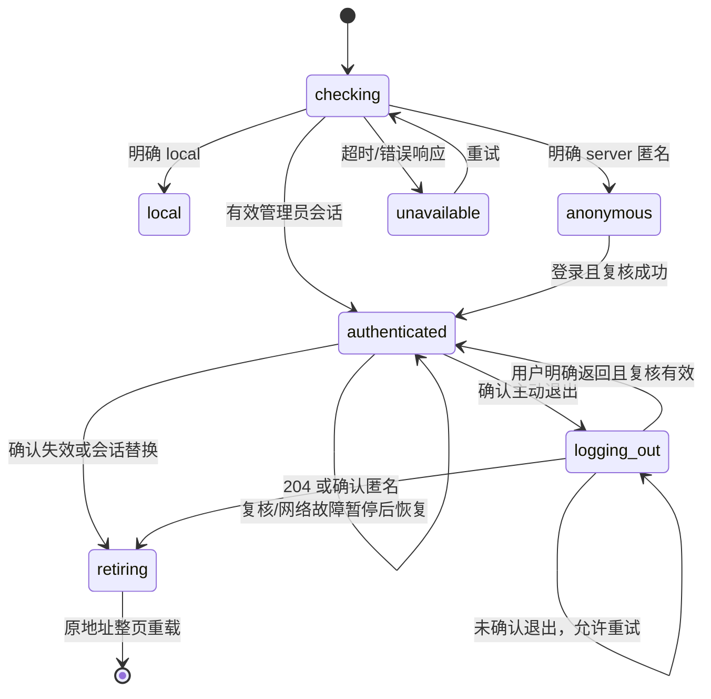

# 第二期设计：管理员 Web 使用闭环

日期：2026-11-04（Asia/Shanghai）

状态：供审核的设计稿；本次用户授权形成设计和计划，尚未实施本期产品代码。
目标：让管理员可以通过 HTTPS 网站完成登录、日常管理、刷新恢复、会话失效处理和退出。

## 1. 从目标推导必须成立的规则

Molio 中有私人知识、AI 任务、账号配置和本机操作能力。对外提供网站后，浏览器中的每一次管理操作，都必须同时满足“服务端允许”和“当前页面属于有效管理员会话”。因此：

1. **服务端为权限事实来源。** 前端根据 `/api/access/session` 渲染；隐藏按钮不能代替 daemon 门禁。无法确认模式或会话时，不推断为 local。
2. **认证覆盖整个管理工作区。** 未确认会话前不挂载业务 App，不拉取知识库、配置、云账号或启动任务控制器。
3. **身份、操作和连接共享会话生命周期。** 退出或失效后，停止旧页面的请求和连接，迟到响应不能恢复旧工作区。
4. **管理员身份独立。** Molio 云账号的邮箱登录、市场管理员身份不能授予本站管理权限；两套登录与退出互不替代。
5. **用户操作只执行一次。** 认证失效、CSRF 错误和断网都不能触发写请求自动重放；登录后只恢复访问位置。
6. **失败须准确表达。** 网络不可达、业务拒绝和管理员会话失效是不同状态；失败时不得静默切换身份、默认知识库或运行时。

本期成功的最小证据是：真实 HTTPS 浏览器中，匿名用户不能看到或操作工作区；管理员能通过表单登录并完成真实读写；刷新保持会话；退出/失效后旧工作区和事件流结束；其他有效会话仍能工作。

## 2. 已知基础与本次依据

- 第一期 daemon 已提供独立 `/api/access/login|session|logout`、12 小时绝对会话、Secure/HttpOnly Cookie、Origin/CSRF 保护和四类管理 SSE 的会话约束。复用其协议，不新增第二套后台认证。
- 2026-11-04 定向复核：服务侧 9 项、真实 Chromium 1 项全部通过，零失败、零跳过；日志位于 `.artifacts/phase1-check-2026-11-04-oEDivC/`。这是一期定向结果，不是本期实现后的验收结果。
- `main.tsx` 目前直接导入并挂载 `App.tsx`。App 首屏启动运行时、配置、云账号及知识库等读取；常驻 `KbChatSessionsProvider` 可恢复后台任务观察。
- `api/client.ts` 有大量独立 fetch；account、resources、知识库链接与导出等模块还绕过 client。任务/知识库使用 EventSource，安装/预加载使用 fetch 流。
- `authStore.ts` 是云账号快照，不能充当本站管理员状态。云账号等业务 API 的 401 也不必然表示本站管理员失效。
- 配置、历史列表和输入草稿等散布于模块级内存。单纯卸载 React 组件不能保证旧缓存被清除。
- `static-files.ts` 当前已有无扩展名 SPA 回退。需要验证构建后的深链刷新，不必先假定需要改 daemon 静态服务。

## 3. 范围与分期

本期交付：管理员登录表单；模式/会话发现；管理工作区入口保护；全量管理请求适配；事件流认证生命周期；刷新、到期、退出、跨标签页同步；server/local 两种模式的浏览器验收。

后续单独设计：公开内容的选择、发布/撤回、快照、公开 Wiki/图谱/附件/搜索；多管理员、权限角色、密码找回、会话管理列表；生产域名、部署与安装器改造。

本期沿用单管理员、单 daemon、同源 HTTPS 反向代理。local 保持本机直接进入，server 登录凭据由既有配置和隐藏输入工具提供。公网发布与 PR 整合另行安排。

## 4. 方案与本稿建议

| 方案 | 收益 | 代价 |
|---|---|---|
| **A：入口统一保护 + 显式管理传输层 + 会话终止后整页重载（建议）** | 清晰覆盖业务入口；重载一次清除模块缓存、控制器与迟到回调；复用既有 App | 已确认失效或成功退出后会清除未提交的内存编辑，需要明确提示 |
| B：入口统一保护 + 显式管理传输层 + 全部状态在 SPA 内按会话隔离 | 可保留更多未提交编辑，退出无需重载 | 要重构并持续维护配置、历史、草稿、图谱和多种 store 的清理/恢复协议；遗漏易复活旧数据 |

本稿采用 A 形成可审核的具体设计，属于助手建议。用户已确认先完成管理员闭环的分期，尚未确认本稿的所有技术和草稿处理取舍。全局替换 `window.fetch`、只增加登录弹窗或逐页打权限补丁不能可靠满足上述规则，不作为实施路线。

## 5. 页面行为

### 5.1 首次进入与深链

- `main.tsx` 挂载 `AccessBoundary`；只有会话为 local 或已认证 server 时才 lazy-import 并挂载现有 App。
- 初次只请求 `GET /api/access/session`。检查中显示简短加载状态，5 秒无结果进入可重试的连接错误状态；不能显示私人工作区或回退 local。
- server 匿名显示独立全页“管理员登录”，包含用户名、密码、提交和错误区域。使用原生表单、Enter 提交、正确 label/autocomplete、可见焦点、`role=alert`；320px 宽度无横向滚动。沿用主题和中英字典。
- 保留当前 pathname、query、hash，不引入 `returnTo` 外跳参数，也不把 Cookie/CSRF 塞进 URL。登录成功仍访问原位置；根路径 `/` 继续由既有 EntryRedirect 决定落点。
- 登录页语言取 `molio.locale` 和本地字典；不挂载会写 `/api/config` 的 LanguageProvider，不以管理接口读取匿名语言配置。

### 5.2 登录

- POST 现有 `/api/access/login`；成功后再 GET session，只有确认 `mode=server, authenticated=true` 才进入 App。
- 提交期间禁止重复提交。失败保留用户名，清空密码；密码不写入日志、URL、localStorage、sessionStorage 或跨标签页消息。
- 401 显示“用户名或密码不正确”；429 按 Retry-After（秒数或 HTTP 日期）显示等待并禁止提前重试；无有效头时提示稍后重试；网络错误显示“无法连接服务器”；403 提示登录请求被拒绝并引导检查站点配置，不能称为密码错误。
- local 不显示管理员登录/退出，也不调用 login/logout；响应字段 `authenticated=false` 不代表 local 用户被锁定。

### 5.3 使用中与失效

- 认证 Cookie 只由浏览器保存。CSRF、expiresAt 和当前页面状态只放内存。
- 可见页面每 30 秒检查一次 session；focus/visibility 恢复、管理请求 401/403、管理流异常、同源私有资源加载失败均可请求复核。复核去重，单次最长 5 秒，不形成错误回调递归。
- 使用响应 Date 与请求耗时估计服务器时间，安排到期前 5 分钟的保存提醒及到期复核。缺少 Date 时使用本机时间估计，但本机时钟不能单独撤销有效服务端会话。到达估计到期点先暂停管理操作并复核。
- 认证后复核遇网络错误：保留“曾认证”的内存事实，显示连接故障；暂停管理操作和流重连，提供重试；既不到登录页声称已退出，也不接受新的写入。初次发现失败保持连接错误页。
- 确认匿名后，立即阻断交互、关闭管理资源，进入终止状态；以 `location.replace` 重载原同源地址。新文档重新发现 session，显示登录页及“会话已失效，请重新登录”的一次性原因提示。
- 登录后重新读取数据，不自动提交旧请求、发送排队消息或重复创建任务。已有 daemon 任务可以通过历史重新观察。

### 5.4 主动退出与未提交内容

- NavRail 增加独立“退出管理员”入口，server 已认证时可见，与现有云账号退出区分。
- 主动退出先显示可取消的确认，说明“退出会清除未保存的编辑和输入草稿；已提交的后台任务可能继续运行”。本稿不承诺跨管理员会话恢复未提交内容。
- 用户确认后进入阻断交互状态，停开新管理请求，关闭观察流；用捕获的有效会话和 CSRF POST logout。
- 204 或后续 session 已确认匿名，才显示成功退出并重载。响应丢失、超时或 5xx 时显示“尚未确认退出”，可重试或检查状态；不能只清 UI 就声称服务端退出。
- 403 时检查 session；仍为同一 CSRF 的有效会话则保持退出失败状态，用户可手动重试或明确返回应用。若 CSRF 已变化，说明 Cookie 已切换到新会话：终止旧退出意图并退场重载，不能用新令牌延续旧退出操作、撤销新会话。401 也先通过 session 确认，避免误判业务响应。
- 重新进入工作区前先重新检查会话、建立新资源作用域。退出状态下遗留的 async 回调不能恢复页面。
- 用户在“未确认退出”状态明确返回应用，且复核仍为原会话时，为已关闭的观察资源创建新 epoch，工作区以新 key 重挂载后恢复读取；不能复用已 close 的作用域。不同 CSRF 仍走会话替换退场。
- **需要审核的取舍：**强制失效可能丢失未保存的内存文本。本稿用到期前提醒、主动退出确认和禁止自动提交控制风险；完整草稿恢复属于方案 B 或后续功能。已保存的知识文件和服务端会话记录保留。

## 6. 状态机与模块接口

`access/session-controller.ts` 为不依赖 React 的状态机，`access/runtime.ts` 装配浏览器适配器；现有云账号 store 不改成管理员 store。

```typescript
type AccessState =
  | { status: 'checking' }
  | { status: 'local' }
  | { status: 'anonymous'; reason?: 'expired' | 'signed-out' | 'revoked' }
  | { status: 'authenticated'; expiresAt: number; csrfToken: string; health: 'ok' | 'unreachable'; epoch: number }
  | { status: 'logging-out'; phase: 'pending' | 'unconfirmed'; message?: string }
  | { status: 'retiring'; reason: 'expired' | 'signed-out' | 'revoked' | 'session-changed' }
  | { status: 'unavailable'; message: string };

interface AccessController {
  getSnapshot(): AccessState;
  subscribe(listener: () => void): () => void;
  start(): () => void;
  revalidate(reason: 'startup' | 'focus' | 'poll' | 'expiry' | 'http-error' | 'stream-error' | 'asset-error' | 'peer'): Promise<AccessState>;
  login(input: AdminLoginRequest): Promise<void>;
  logout(): Promise<void>;
  resumeAfterFailedLogout(): Promise<void>;
}
```

`createAccessController(deps: AccessDependencies): AccessController` 显式注入 rawFetch、时钟/定时器、资源作用域、退场回调、跨标签页通知适配器；测试使用受控依赖而非修改生产 API。

约束：异步操作带递增世代号，并取消被替代的 raw access 请求；本页面的 logout/retiring 优先于更早的登录或 session 响应，不能只丢 JSON 却放任旧请求继续。不同标签页的新登录以服务端实际会话为准，旧退出不得覆盖新会话。session 复核同一时刻至多一个；start/stop 在 StrictMode 下幂等。`retiring` 最多调用一次重载。store 订阅快照引用稳定。



## 7. 管理请求与状态码

`api/http.ts` 提供 `daemonFetch(input: string | URL, init?: RequestInit): Promise<Response>`。它只接受本页同源的 `/api/` URL；拒绝外部地址，避免令牌外泄；不替换全局 fetch。

- 读取使用 `credentials: 'same-origin'`、`cache: 'no-store'`。安全方法为 GET/HEAD/OPTIONS；server 其他方法合并 `X-Molio-CSRF`。浏览器自然发送 Origin，不手工伪造。
- 合并 Headers、保留 signal/body；FormData 不能被强行添加 JSON Content-Type。调用方取消与当前会话取消共同生效，结束时释放监听。
- access 的 session/login/logout 由 controller 使用独立 rawFetch，防止复核递归；其他 daemon API，包括 `/api/auth/*` 和市场请求，都经过 daemonFetch。
- 初始 401/403 是复核线索：先 raw session。若仍为相同 CSRF 的有效会话，把原响应交回原业务错误处理，不自动登出、不自动重试。若 CSRF 不同，按会话替换退场；若确认匿名则终止当前会话；探测失败显示连接问题，不伪造匿名。禁止从旧操作切换到新会话继续执行。
- 响应归属于发起时的 epoch；已终止作用域的响应不得返回给业务层。所有写请求最多发送一次；认证恢复不能自动重放已发请求。
- 外部支付、OSS 预签名下载及代码主题静态资源继续使用原生 fetch，不携带管理员 CSRF。动态 URL 的导出请求先分类，同源 `/api/` 走 daemonFetch，其余保留原有规则。

## 8. 连接、资源与浏览器生命周期

`access/resources.ts` 暴露 `SessionResources`：`epoch`、`signal`、`track(dispose: () => void): () => void`、`close(): void`；close 幂等并释放全部资源。每次有效会话新建作用域，close 后不复用。

- 两处 EventSource（`api/sse.ts`、`useKnowledge.ts`）统一经 `api/managed-events.ts` 创建并登记；返回自有句柄 `ManagedEventSubscription { close(): void; reconnect(): void }`，不伪装成可重新打开的原生 EventSource。它通过 `onMessage` 和 `onState` 回调暴露数据及 `open/checking/reconnecting/paused/closed` 状态。
- **server 网络恢复由 managed-events 负责。** 原生 EventSource 报错先 close，去重复核 session；同一有效会话最多自动重建 4 次，延迟依次 1/2/4/8 秒。收到有效数据或 keepalive 后重置计数；超限进入 paused，等待用户重试。知识库流同样自动恢复。网络不可达时暂停，controller 复核恢复后允许新的有界恢复周期。
- 任务流每次重建使用 `url: () => string` 生成包含最新 `after=<seq>` 的 URL；不会重建任务。认证暂停、失效、重试耗尽和原生 CLOSED **不调用 server 模式的 onDone**，也不清 runId 或 drain 队列。业务完成由已有协议事件处理。paused 时提供可见的连接重试动作，仍只观察原 run。
- 已结束任务可能“回放为空后直接关流”。这种情况允许在当前相同有效会话内读取 `/api/runs/:id`，仅 `succeeded/failed/canceled` 才提供业务完成证据并结束观察；running/pending/404/网络错误均不是完成证据，不自动新建任务或发送队列。关闭后校准/补拉历史不得重复应用已有消息，响应仍受 epoch 保护。
- `subscribeToRun` 保留现有参数并追加可选 `onTransportState`，返回 ManagedEventSubscription；useChatCore 删除直接包装原生 onmessage 的写法，完成事件观察移入现有 onEventCb。静默但 OPEN 的 watchdog 仍可调用句柄 reconnect；checking/reconnecting/paused 时暂停 watchdog 和 fallback，避免与恢复循环竞争。drain 和新发送都必须确认会话与传输可用；local 的原有 CLOSED/onDone 行为通过适配保留。
- API 层对重连和新建请求再次检查资源作用域，避免 UI 计时器晚一拍执行。close 为终止性操作，手工 close、会话终止后不得恢复；暂时连接错误使用内部暂停，不能混同 close。管理操作被暂停时，事件回调也不能把隐藏工作区重新激活。
- 暂停与重试动作经 useChatCore → KbChatSessionController → ChatSessionView 传到全屏和悬浮两种会话视图，两处都明确显示连接状态；不要求用户寻找开发者工具才能恢复。
- 安装和预加载的 fetch/reader 关联作用域 AbortSignal，退出时取消读取；保留既有安装中止语义。任务与知识库观察流关闭不额外发送 cancelRun/shutdown。
- 图片/附件读取依靠同源 Cookie，由 daemon 验证；PDF.js 自有读取在组件卸载时销毁。图片捕获阶段 error、PDF 加载错误只触发去重复核，不把“文件坏了/404”当成登出。URL 不加认证令牌。
- `pagehide` 先遮蔽工作区并关闭当前观察资源；`pageshow.persisted` 保持遮蔽并重载后重新检查，防止后退缓存恢复私人页面。普通 focus/visibility 只复核，不无条件重载。
- 到期复核或连接故障暂停时可以保留已挂载树的内部状态，但工作区被不可交互的遮层完全覆盖；只有有效复核后再恢复。**已确认匿名/退出时立即卸载私有树**，随后重载清除模块缓存。
- 边界的“是否曾挂载”和“是否可交互”分开：初次未决不创建 App；已认证后的暂时故障或未确认退出保留树并遮蔽，不能因 health 变化误卸载；会话终止卸载。资源 epoch 改变时工作区重挂载，普通轮询有效则不重挂载。

跨标签页用 BroadcastChannel；不支持时用 localStorage 的短暂事件键。消息仅 `{type:'session-changed', nonce, at}`，不含会话/CSRF/用户名/文档。收到消息暂停并复核；消息不是授权事实。登录、成功退出和确认会话变化发通知。已认证页面若复核发现 CSRF 变化，视为同浏览器 Cookie 已被新登录替换，关闭旧作用域并重载；不把旧流带进新会话。匿名页面收到通知后复核有效即可登录进入。隐藏标签页恢复可见时必须复核。独立浏览器会话之间不传播退出。

## 9. 迁移清单与文件职责

新增：

| 文件 | 单一责任 |
|---|---|
| `apps/web/src/access/session-controller.ts` | 模式、会话及登录退出状态机，协议校验与竞态规则 |
| `apps/web/src/access/resources.ts` | 请求/连接的取消与资源登记 |
| `apps/web/src/access/runtime.ts` | controller 单例、浏览器事件、跨标签页通知与一次性重载提示 |
| `apps/web/src/access/AccessBoundary.tsx` | 入口渲染、私有树挂载/遮蔽/卸载、lazy App |
| `apps/web/src/components/access/AdminLoginPage.tsx` | 登录表单及错误/等待交互 |
| `apps/web/src/components/access/AdminSessionControls.tsx` | 退出入口、确认、到期/连接故障提示 |
| `apps/web/src/styles/admin-access.css` | 上述轻量界面样式，沿用设计 token |
| `apps/web/src/api/http.ts` | 仅同源 daemon 请求的认证传输 |
| `apps/web/src/api/managed-events.ts` | EventSource 创建、登记及会话复核衔接 |

修改入口与 UI：`main.tsx`、必要的 `App.tsx` 接线、`NavRail.tsx`、`i18n/locales/zh.ts`、`en.ts`。保留现有路由常量与 App 内云账号 LanguageProvider。

迁移请求：

- `api/client.ts` 全部 daemon fetch。
- `hooks/useMarketCatalog.ts`、`useWikiLinkClick.ts`。
- `components/account/AccountPage.tsx`、`ListingsSection.tsx`、`PurchasesSection.tsx`。
- `components/resources/ResourceDetailPage.tsx`、`PublishForm.tsx`、`TaxonomyFields.tsx`、`resourceAction.ts`。
- `components/kb/KnowledgeBasePage.tsx`、`KbMainContent.tsx`、`MdTypesetEditor.tsx`、`docExport/dom.ts`。
- `api/sse.ts`、`hooks/useKnowledge.ts`、`useChatCore.ts` 的流和重连；`components/kb/KbChatSessionController.tsx`、`KbChatSession.tsx`、`components/ChatSessionView.tsx`、`HomePage.tsx` 的暂停/重试状态接线；`PdfViewer.tsx` 的失败复核与卸载清理。

验收前重新搜索 fetch/EventSource/资源 URL，发现新增 daemon 调用一并纳入。保留原有业务解析、404 行为和错误码；不借迁移改变市场、链接、付费等行为。`MdRenderer.tsx` 的代码主题资源和 `useResourcePay.ts` 的外部支付请求属于保留原生 fetch 的已知例外。

本稿不要求修改 daemon 的认证协议、数据库或 desktop/cloud 产品代码。真实浏览器夹具增加于 `apps/web/e2e/fixtures/admin-server.ts`；验证生产构建的静态路由现有行为，有发现再提出最小修复和对应测试。

## 10. 验收与证据

新增 `admin-access-ui.spec.ts`（`@area auth`、P0），保留一期 `admin-access-server.spec.ts`（P1）。area-map 同时注册新文件、access 模块和传输入口，不能只添加注释。

| 编号 | 必须证明的行为 | 证据层 |
|---|---|---|
| A01 | session 未决/不可达时不挂载工作区、不发私有请求、不回退 local | controller + 浏览器网络记录 |
| A02 | 表单登录、错误密码、429 等待；成功后原路径/query/hash保留 | 真实 HTTPS UI |
| A03 | server 真实读取、JSON 写入、FormData 上传；匿名/缺 CSRF 仍拒绝 | 真实 HTTPS UI/API |
| A04 | 云账号 401、业务 403、网络失败不会伪造管理员登出；写请求不重放 | 受控协议测试 + 浏览器 |
| A05 | 刷新恢复；到期提醒/复核；迟到 session/200/401 不反转退出 | 状态转换测试 + HTTPS UI |
| A06 | 主动退出取消/确认、成功退出；响应丢失/断网为“未确认”；可重试 | 真实 HTTPS + 故障注入 |
| A07 | 退出/失效清除私有 DOM，流关闭，无新 run/排队消息/重复写入 | UI + 四类流生命周期测试 |
| A08 | 同 Cookie 的两个标签页同步；另一 browser context 有效会话不误伤 | 多页面/多 context HTTPS |
| A09 | 图片/PDF/下载受保护，不能通过 URL 偷渡 token；外部请求无 CSRF | 真实资源 + 请求头断言 |
| A10 | 构建后深链刷新、后退缓存/focus恢复受保护；语言切换无匿名写入 | 静态构建 HTTPS + UI |
| A11 | local 直接使用且无管理员退出；云账号登录/退出含义保持原样 | local E2E + 既有回归 |
| A12 | 关键新增交互键盘可用、320px可见，已有关键流程全量回归 | UI检查 + 完整 Web E2E |

真实 server UI 夹具：worker 中将本次 Web 源码构建到临时 outDir；每个测试独立 daemon、SQLite、知识库、runtime home、随机账号和 HTTPS 代理端口，`MOLIO_STATIC_DIR` 指向该构建。复用一期密码算法与安全 Cookie；不增加生产免密/短会话接口，不使用真实用户目录。夹具总超时单独设置，失败输出可诊断的脱敏日志，finally 清理子进程、代理和临时目录。

到期测试允许只在夹具内用 SQLite 将指定测试会话 `expires_at` 设置为过去，再触发真实 session 复核；同进程流到期计时与清理另由受控时钟驱动现有 store/stream 集成测试证明。两者分别标注，不能把改数据库等同为等待真实 12 小时。浏览器网络故障与状态机时间推进不使用固定 sleep 掩盖失败。

最终报告逐条映射 A01–A12；列出命令、退出码、通过/失败/跳过数量、日志/截图/Trace、真实未验证范围。触及 main/App/client/sse/useChatCore 等核心文件，按仓库门禁执行一次完整连续 Web E2E；不将定向重跑拼成全绿结论，不把 2026-10-30 历史结果当作本期证据。

## 11. 审核时需要看清的决定

1. 本期只完成管理员闭环，公开发布模型仍待后续选择。
2. 本稿推荐会话终止后整页重载，未提交内存内容的处理见 §5.4；若要求自动恢复，应先调整此设计及工作量。
3. 本期保持单管理员与同源 HTTPS，沿用一期 Cookie 和 12 小时不续期规则。
4. 设计与计划获确认后再实施；文档形成不代表合并、推送或生产部署授权。

## 12. 文档评审记录

2026-11-04 独立可实施性审阅提出两处问题：CSRF 变化时退出重试与会话替换规则冲突；原生 EventSource 关闭后恢复责任不清。已统一为“旧操作不能撤销新会话”和“自有订阅句柄、传输层负责 server 网络恢复、认证暂停不触发任务完成”。复核结论为无同等级的重要规划缺口。其后作者自检补充了已终止任务空回放、暂停树保留与新epoch恢复的行为。此处记录的是文档审阅，不是实现通过测试的结论。
